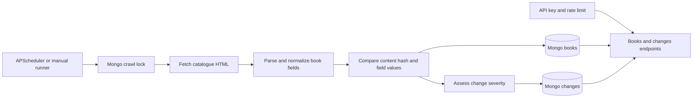
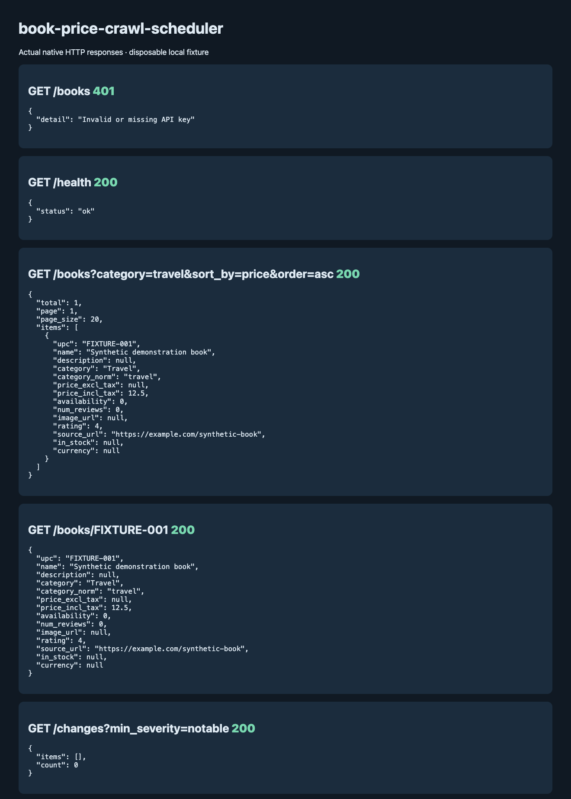

# Books Monitor

Crawls the books.toscrape.com catalogue, records what changed since the last crawl, and serves books and changes through a small REST API with API keys and rate limiting. Each detected change gets a severity (critical, notable, minor, cosmetic) so the feed can be filtered down to the ones worth looking at.

Stack: FastAPI, MongoDB via Motor, httpx, BeautifulSoup, APScheduler, pytest.

## Features

- Async crawler with content hashing and field-level diffs
- Severity rules in `app/analysis/significance.py` (large price moves and going out of stock are critical; description or image only changes are cosmetic)
- `GET /books` with category, price range, rating filters, sorting and paging
- `GET /books/{book_id}` by UPC, with `include_raw=true` for the stored HTML and hash
- `GET /changes` with `since`, `type`, `severity`, `min_severity`, `order=recent|severity`, `limit` and `offset`
- Daily scheduled crawl (cron or interval), Mongo based locks so two crawls don't overlap

## Running with Docker

```bash
docker compose up -d --build
```

This starts MongoDB, runs a one-off crawl, and then starts the API on http://localhost:8800 (Swagger UI at `/docs`). Every route, including `/health`, needs an `X-API-Key` header. The default key is `dev-key-1`.

```bash
curl -H 'X-API-Key: dev-key-1' 'http://localhost:8800/changes?min_severity=notable&order=severity&limit=5'
```

## Running without Docker

You need a local MongoDB.

```bash
python -m venv .venv && source .venv/bin/activate
pip install -r requirements-lock.txt
cp .env.example .env
python -m app.crawler.runner          # one full crawl
uvicorn app.api.main:app --reload     # API on port 8000
```

With `RUN_SCHEDULER_IN_API=true` (the default in `.env.example`) the API also runs the scheduled crawl. The scheduler can be run on its own with `python -m app.scheduler.main`.

Main settings: `MONGODB_URI`, `MONGODB_DB`, `API_KEYS` (comma separated), `RATE_LIMIT_PER_HOUR`, `SCHEDULER_CRON`, `SCHEDULER_INTERVAL_SECONDS`, `CONCURRENCY`.

## Tests

```bash
docker compose run --rm --no-deps api python -m pytest tests/ -q
```

or `pytest` from a local virtualenv. The API and crawler tests swap in an in-memory fake DB from `tests/utils/fake_db.py`.

## Notes

- The 20% and 5% price thresholds are fixed defaults, not tuned per title.
- Description edits are always treated as cosmetic, even if the meaning changes.
- Changes stored before severity was added have `severity: null` and are skipped by the severity filters.

## Crawl and query flow



## Verified native API example



The [response capture](docs/native-api.json) comes from a real disposable MongoDB
with one explicitly synthetic book. It verifies API-key enforcement, normalized
category filtering, pagination, and detail lookup. The scheduler was disabled;
this check did not crawl the public website. The crawler's parsing and change
rules are exercised by the offline suite.

`requirements.txt` holds dependency inputs; `requirements-lock.txt` freezes the
Python 3.12 environment used for the local checks and CI. The unit/API tests use
the repository's fake database; the native capture uses MongoDB itself. Docker
images have not been built or booted in this environment.

## Author

[**Muhammad Nadeem**](https://github.com/dev-mnadeem)
