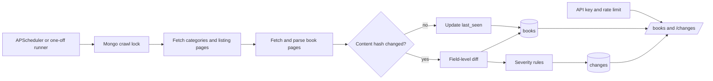

# Books Monitor

Crawls a book shop catalogue on a schedule, records what changed since the last crawl, and serves the books and the change feed through a small REST API with API keys and rate limiting.

A full crawl of a thousand titles produces hundreds of change rows a day, and a 30% price cut looks no different from a reworded blurb. Each change is therefore given a severity (`critical`, `notable`, `minor`, `cosmetic`) and a reason in plain words, so the feed can be cut down to the few rows someone should look at today.

The crawler is written for [books.toscrape.com](https://books.toscrape.com), a public sandbox built for scraping practice. The repository also ships an offline copy of a shop in the same markup (`demo/site/`), which the Docker setup and the tests use by default.

Stack: Python 3.12, FastAPI, MongoDB through PyMongo's async client, httpx, BeautifulSoup, APScheduler, pytest and ruff.

## What it does

- Walks every category and listing page, then fetches each book's detail page through one pooled HTTP client, with bounded concurrency and retries for 429/5xx and dropped connections. A 404 fails straight away.
- Hashes a normalised copy of each book. A changed hash produces a field-level diff and a change row; an unchanged one only updates `last_seen`.
- Rates every change with the rules in `app/analysis/significance.py`:

  | Severity | Triggered by |
  | --- | --- |
  | critical | price moved 20% or more, or the book went out of stock |
  | notable | price moved 5–20%, back in stock, stock fell to 5 or fewer, title renamed, new title |
  | minor | smaller price or stock moves, rating, review count or category changes |
  | cosmetic | only the description or image changed |

- Serves `GET /books` (category, price range and rating filters, sorting, paging), `GET /books/{upc}` (with `include_raw=true` for the stored HTML and hash) and `GET /changes` (`since`, `type`, `severity`, `min_severity`, `order=recent|severity`, `limit`, `offset`).
- Runs the crawl daily from APScheduler, either inside the API process or as its own process. A Mongo lock keeps two crawls from overlapping, and an interrupted crawl resumes at the first category it had not finished.
- After each scheduled crawl, writes the day's changes to `reports/YYYY-MM-DD.json`. `success_runs/2025-09-30.json` is one of these from a real crawl of the sandbox, written before severities were added.

## Quick start (Docker)

```bash
docker compose up -d --build
```

This starts MongoDB, a static server for the demo shop, a one-off crawl of the shop's first edition and then the API on http://localhost:8800 (Swagger UI at `/docs`). Every route, including `/health`, needs an `X-API-Key` header. The default key is `dev-key-1`.

The demo shop has a second edition, `v2`, which is the same catalogue a day later. Crawl it to fill the change feed:

```bash
BASE_URL=http://shop:8080/v2/ docker compose run --rm crawl
curl -H 'X-API-Key: dev-key-1' 'http://localhost:8800/changes?type=update&order=severity&limit=3'
```

To crawl the real sandbox instead, start the stack with `BASE_URL=https://books.toscrape.com/`. A full crawl of the sandbox fetches a little over a thousand pages.

`docker compose down -v` stops everything and removes the database volume.

## API examples

These were captured from the Docker stack above after crawling `v1` and then `v2`. Long arrays are trimmed.

`GET /changes?type=update&order=severity&limit=3`

```json
{
  "items": [
    {
      "book_upc": "demo000000000102",
      "change_type": "update",
      "changes": [
        { "field": "availability", "old": 4, "new": 0 },
        { "field": "in_stock", "old": true, "new": false }
      ],
      "timestamp": "2026-11-07T22:48:57.502000Z",
      "severity": "critical",
      "reasons": ["went out of stock"],
      "signals": { "availability_old": 4, "availability_new": 0, "fields_changed": ["availability", "in_stock"] }
    },
    {
      "book_upc": "demo000000000101",
      "change_type": "update",
      "changes": [
        { "field": "price_excl_tax", "old": 40.0, "new": 28.0 },
        { "field": "price_incl_tax", "old": 40.0, "new": 28.0 }
      ],
      "timestamp": "2026-11-07T22:48:57.501000Z",
      "severity": "critical",
      "reasons": ["price fell 30% (40.00 → 28.00)"],
      "signals": { "price_old": 40.0, "price_new": 28.0, "price_change_pct": -30.0, "fields_changed": ["price_excl_tax", "price_incl_tax"] }
    },
    {
      "book_upc": "demo000000000201",
      "change_type": "update",
      "changes": [{ "field": "availability", "old": 15, "new": 3 }],
      "timestamp": "2026-11-07T22:48:57.511000Z",
      "severity": "notable",
      "reasons": ["stock low: 15 → 3"],
      "signals": { "availability_old": 15, "availability_new": 3, "fields_changed": ["availability"] }
    }
  ],
  "count": 3
}
```

`GET /books?category=travel&sort_by=price&order=asc&page_size=2`

```json
{
  "total": 5,
  "page": 1,
  "page_size": 2,
  "items": [
    {
      "upc": "demo000000000102",
      "name": "Night Trains to Anywhere",
      "description": "Sleeper carriages, missed connections and the strangers met between them.",
      "category": "Travel",
      "category_norm": "travel",
      "price_excl_tax": 18.4,
      "price_incl_tax": 18.4,
      "availability": 0,
      "num_reviews": 0,
      "image_url": "http://shop:8080/media/cache/night-trains-to-anywhere_102.jpg",
      "rating": 3,
      "source_url": "http://shop:8080/v2/catalogue/night-trains-to-anywhere_102/index.html",
      "in_stock": false,
      "currency": "GBP"
    },
    { "upc": "demo000000000104", "name": "Harbour Lights and Ferries", "price_incl_tax": 19.5, "...": "..." }
  ]
}
```

Errors:

```text
GET /books                            (no key)  -> 401 {"detail":"Invalid or missing API key"}
GET /changes?since=yesterday                    -> 422 {"detail":"'since' must be an ISO 8601 timestamp"}
GET /books (101st call in an hour, same key)    -> 429 {"detail":"Rate limit exceeded"}
```

## Running without Docker

You need Python 3.12 and a MongoDB you can reach.

```bash
python -m venv .venv && source .venv/bin/activate
pip install -r requirements-lock.txt
cp .env.example .env              # BASE_URL here is the public sandbox
python -m app.crawler.runner      # one full crawl
uvicorn app.api.main:app --reload # API on port 8000
```

With `RUN_SCHEDULER_IN_API=true` (the default in `.env.example`) the API also runs the scheduled crawl, plus one crawl at startup unless `SCHEDULER_RUN_ON_START=false`. `python -m app.scheduler.main` runs the scheduler on its own.

Settings, all read from the environment or `.env`:

| Variable | Default | Purpose |
| --- | --- | --- |
| `MONGODB_URI`, `MONGODB_DB` | `mongodb://localhost:27017`, `books_monitor` | database |
| `BASE_URL` | `https://books.toscrape.com` | shop to crawl |
| `CONCURRENCY`, `REQUEST_TIMEOUT`, `MAX_RETRIES` | `12`, `20`, `3` | crawler limits |
| `API_KEYS` | `dev-key-1` | comma separated, or a JSON array |
| `RATE_LIMIT_PER_HOUR` | `100` | per key, token bucket |
| `SCHEDULER_CRON` | `0 2 * * *` | daily at 02:00 |
| `SCHEDULER_INTERVAL_SECONDS` | unset | if set, used instead of the cron |

## Tests and lint

```bash
docker compose run --rm --no-deps api python -m pytest -q
docker compose run --rm --no-deps api ruff check .
```

The unit and API tests use an in-memory fake database (`tests/utils/fake_db.py`). Crawler tests read the saved pages in `demo/site/`, so nothing touches the network. `tests/test_mongo_integration.py` runs the same demo crawl, the severity-ordered aggregation and lock expiry against a real MongoDB, and is skipped unless `MONGODB_TEST_URI` is set:

```bash
docker compose run --rm -e MONGODB_TEST_URI=mongodb://mongo:27017 api python -m pytest -q
```

Locally, install `requirements-dev.txt` and run `pytest` and `ruff check .`.

## How it fits together



## Design notes

- **Rules, not a model.** "Did the price move more than 20%?" has an exact answer, and the rules give the same answer every time. The 20% and 5% thresholds are fixed defaults, not tuned per title.
- **Severity is stored when the change is detected.** Recomputing it on read would quietly reclassify history whenever a threshold changed. Changes stored before severities were added have `severity: null`, and the severity filters skip them.
- **Description edits are always cosmetic**, even when the meaning changes. Telling a reword from a real change would need a language model, and that is left as a known limitation.
- **The worst signal wins.** A change that both cut the price 30% and fixed a typo is critical. Averaging the signals would hide it.
- **Hashing a normalised copy** (trimmed whitespace, lower-cased category, rounded prices) keeps formatting noise from looking like a change. Stored documents are rehashed on comparison, so a change to the hashing rules does not flag the whole catalogue.
- **Resuming by category.** The crawl stores each category's books before moving its cursor, so a crash costs at most one category of work.
- **The demo shop serves both editions from one host** with root-relative image paths, so that an image URL, which is part of the hash, reads the same in `v1` and `v2`. `python demo/build_site.py` regenerates it.

## License

MIT, see [LICENSE](LICENSE).
